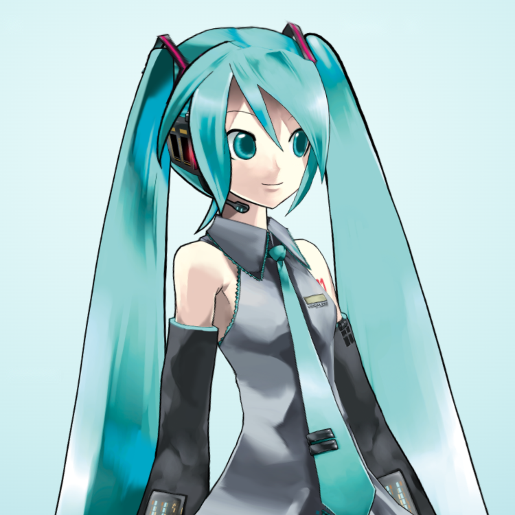

<h1 align="center">Hi, I'm Duc Luu</h1>

  Building software with AI agents, and agents that build software. 
  TypeScript on the front, Go on the back, a bit of Rust on the side.

  

---

## What I'm up to

- **At work:** automating AI-assisted development with AI-DLC and a software factory, so human and AI code meet the same bar.
- **Agents:** building AI agents for work and for myself.
- **Day to day:** TypeScript for frontend, and Go for backend and cloud microservices.
- **Side project:** Play with Raspberry Pi, and learning Rust.

## Featured projects

| Project                                                                           | What it is                                                                                                                               |
| :-------------------------------------------------------------------------------- | :--------------------------------------------------------------------------------------------------------------------------------------- |
| [**software-factory**](https://github.com/tienduc120/software-factory)       | Installable kit of coding standards, agent instructions, and CI gates for TypeScript/Node projects.                                      |
| [**go-base**](https://github.com/tienduc120/go-base)                         | Go base for strict DDD and clean-architecture microservices that AI agents extend, with rules that tools check and skills agents follow. |
| [**typescript-base**](https://github.com/tienduc120/typescript-base)         | Reusable TypeScript monorepo: NestJS API and worker, Next.js frontend, shared types, auth, roles, and audit trail.                       |
| [**agent-assurance-kit**](https://github.com/tienduc120/agent-assurance-kit) | Black-box evaluation and red-team kit for AI chat and voice agents, with findings mapped to OWASP and MITRE ATLAS.                       |

## Just for fun

**[Miku](https://www.dora-tech.net/pikapi/miku/)**: an AI voice bot I built for my child.

Hatsune Miku, © Crypton Future Media, Inc. 2007, licensed under CC BY-NC.
